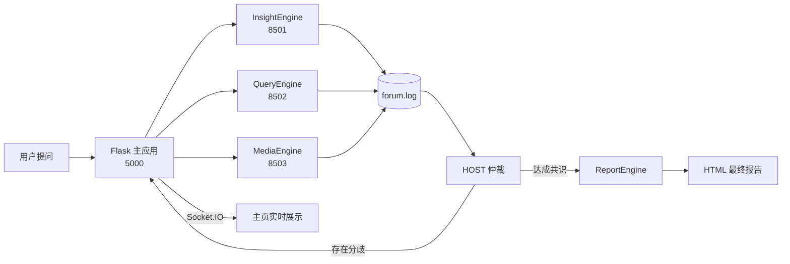

<div align="center">

# Synapse Run

**智能跑步训练助手 | 多智能体协作系统**

<p>
<kbd>Python 3.11</kbd>&nbsp; <kbd>MySQL 8.0</kbd>&nbsp; <kbd>v1.1</kbd>
</p>

</div>

---

## 🎉 v1.1 阶段说明

**当前阶段**：Iteration 4 已完成，在 Iteration 3 的完整"提问 → 三引擎分析 → 论坛协作 → HOST 仲裁 → 多轮复跑 → 最终报告"闭环之上，补齐了用户账号与个性化画像。

### ✨ 本阶段交付

1. **🧭 多轮调度器**：第 1 轮三引擎并行，HOST 仲裁后仅复跑存在分歧的引擎（默认最多 2 轮）
2. **📘 报告引擎**：从 21 套中文模板中自动选型，生成单文件 HTML 报告，支持在线预览与下载
3. **🎨 可视化配置页**：在线修改 LLM / 数据库 / 搜索 API / 调度参数，附带四项健康检查
4. **💬 实时论坛**：基于 Socket.IO 推送专家发言、轮次标记与 HOST 仲裁卡片
5. **📂 训练数据管理**：本地 Excel 手动导入，数据统一入 MySQL，支持增删改查
6. **👤 用户账号与个性化画像**：注册 / 登录、8 字段个人档案，画像自动注入三个子引擎与最终报告

---

## 📖 项目简介

**Synapse Run** 是一款面向中长跑爱好者的智能训练助手。跑者在制定训练计划时，往往同时面对三类割裂的信息：自己的历史训练数据、运动科学文献、赛事与装备等实时情报。任何单一来源都难以给出完整答案。

系统把这三类信息分别交给三位专职 Agent，用"论坛 + 总教练仲裁"的方式协作：各 Agent 在独立的 Streamlit 进程中运行并发布阶段性结论，HOST 汇总后识别共识、分歧与盲区，必要时只让有分歧的 Agent 补充研究一轮，最后由报告引擎整合为一份可执行的训练建议。

> 目标产出：输入一个问题（如"如何提升 10 公里成绩"），在数分钟内得到**有数据支撑、有文献依据、有落地建议**的统一报告。

### 🎯 核心优势

- **🧠 多智能体协作**：三位专家并行分析、论坛发言、HOST 仲裁，避免单一视角的局限
- **📊 数据驱动**：运动科学家直接查询个人训练数据库，结论基于真实训练负荷
- **🔁 条件复跑**：只在存在分歧时才追加一轮，兼顾结论质量与运行成本
- **📄 模板化报告**：21 套中文报告模板自动选型，输出可离线打开的单文件 HTML
- **👤 个性化分析**：登录用户填写 8 字段档案后，画像随提问进入三个引擎与最终报告
- **🔌 轻量化设计**：纯 Python、模块化、兼容任意 OpenAI 格式的 LLM 接口

### ⚡ 技术栈

| 类别 | 技术 |
|------|------|
| **核心语言** | Python 3.11 |
| **Web 框架** | Flask（主应用）+ Streamlit（引擎运行界面） |
| **LLM 接口** | Qwen-plus-latest、Qwen-max-3 |
| **数据库** | MySQL 8.0+ / SQLAlchemy / PyMySQL |
| **登录与会话** | Flask Session + Werkzeug 密码哈希 |
| **搜索工具** | Tavily API、博查（Bocha）AI Search |
| **前端** | HTML5、JavaScript、Socket.IO |

---

## 🏗️ 系统架构

### 多智能体组成

系统由三个分析 Agent、一个 HOST 主持人、一个报告 Agent 组成：

| Agent | 定位 | 核心工具 | 使用模型 | 主要职责 |
|-------|------|---------|---------|---------|
| **InsightEngine** | 运动科学家 | MySQL 训练数据查询 | Qwen-Plus-Latest | 分析历史训练负荷、配速、心率表现 |
| **QueryEngine** | 理论专家 | Tavily 学术搜索 | Qwen-Plus-Latest | 检索运动科学文献，提供理论依据 |
| **MediaEngine** | 实用情报专家 | 博查 AI Search | Qwen-Plus-Latest | 赛事报名、装备、路线、天气等情报 |
| **HOST（主持人）** | 总教练 | 论坛发言 + 仲裁 | Qwen-Plus-Latest | 汇总共识、识别分歧与盲区、决定复跑 |
| **ReportEngine** | 报告生成器 | 模板选择 + HTML 生成 | Qwen-Max | 选型模板并生成最终 HTML 报告 |

> 三位分析引擎在生成提示词前会读取当前登录用户的画像；未登录或未填写档案时自动使用默认画像，不影响原有分析流程。

### 🔄 系统架构图



**核心工作机制**：

1. **用户提问** → Flask 主应用接收训练问题
2. **并行启动** → 调度器拉起三个独立 Streamlit 进程
3. **论坛协作** → 各 Agent 将结论写入 `logs/forum.log` 并实时推送主页
4. **HOST 仲裁** → 汇总发言，输出共识 / 分歧 / 盲区 / 复跑建议
5. **条件复跑** → 存在分歧时只让相关 Agent 带着指引补充一轮
6. **报告生成** → 报告引擎选型模板，整合三份报告与仲裁结论生成 HTML

### 📊 完整工作流程

| 步骤 | 阶段名称 | 主要操作 | 参与组件 | 循环特性 |
|------|----------|----------|----------|----------|
| **1** | 用户提问 | 主页输入问题并启动 | Flask 主应用 | - |
| **2** | 第 1 轮并行 | 三引擎同时分析 | 三个 Agent 进程 | - |
| **3** | 论坛发言 | 各 Agent 写入结构化发言 | ForumEngine | - |
| **4** | HOST 仲裁 | 识别共识、分歧、盲区 | HOST + LLM | - |
| **5** | 条件复跑 | 仅复跑有分歧的引擎 | 调度器 + 相关 Agent | 最多 1 次 |
| **6** | 报告生成 | 模板选型 + HTML 渲染 | ReportEngine | - |
| **7** | 结果展示 | 预览、下载、各引擎报告 | Flask + Socket.IO | - |

### 🧩 项目内 Agent 结构

本项目采用**简化 Agent 结构**：不拆分 nodes / state / prompts 分层，每个引擎以单个 `agent.py` 完成
"规划段落 → 逐段检索/查库 → 汇总报告"的流程，便于调试与二次开发。

---

## 🚀 快速开始

### 前置准备

#### 【1】环境配置

| 环境 | 要求 | 说明 |
|------|------|------|
| **Python** | 3.11 | 支持 Conda 或系统 Python 两种方式（见部署流程） |
| **MySQL** | 8.0+ | 字符集需为 utf8mb4 |

**Conda 下载地址**（未安装 Conda 时先安装，二选一）：

| 发行版 | 下载地址 | 说明 |
|--------|---------|------|
| **Miniconda** | https://docs.conda.io/projects/miniconda/en/latest/ | 体积小，仅含 conda 与 Python，够本项目使用 |
| **Anaconda** | https://www.anaconda.com/download | 体积大，自带常用科学计算包，安装即用 |

Windows 安装后从开始菜单打开 **Anaconda Prompt**（或 Miniconda Prompt）再执行后续命令；若勾选了 "Add to PATH"，也可直接在 PowerShell 中使用 `conda`。

#### 【2】申请 API 密钥

| API 服务 | 用途 | 申请地址 |
|---------|------|---------|
| **阿里云 DashScope** | 子引擎、HOST、报告引擎 | https://dashscope.aliyun.com/ |
| **Tavily** | 学术文献与理论检索 | https://www.tavily.com/ |
| **博查 Bocha** | 赛事、装备、路线等情报 | https://open.bochaai.com/ |

⚠️ **注意**：博查需使用 `ai-search` 接口（项目已固定调用 `https://api.bocha.cn/v1/ai-search`）。

#### 【3】数据准备

训练数据仅支持**本地 Excel 手动导入**，Excel 需包含以下 8 列：

`运动类型`、`运动时长(秒)`、`开始时间`、`结束时间`、`卡路里`、`运动距离(米)`、`平均心率`、`最大心率`

列名允许常见同义写法；导入后数据写入 MySQL，Excel 文件本身不再被依赖。

---

### 📦 部署流程

#### 1️⃣ 获取项目

```bash
git clone https://github.com/xsz111-q/Run_assistant.git
cd Run_assistant
```

#### 2️⃣ 安装依赖（强烈推荐使用conda）

**方式 A：Conda 环境**（安装包下载地址见 [前置准备 · 环境配置](#1环境配置)）

```bash
conda --version                 # 能输出版本号说明 Conda 已就绪
conda create -n synapse_run python=3.11 -y
conda activate synapse_run
pip install -r requirements.txt
```

**方式 B：系统 Python**

```bash
# 确认系统 Python 为 3.11
python --version

# Windows PowerShell
python -m venv .venv
.venv\Scripts\Activate.ps1

# macOS / Linux
python3 -m venv .venv
source .venv/bin/activate

pip install -r requirements.txt
```

两种方式装入的依赖完全相同，后续步骤通用；只需在每次启动前激活对应的环境。

#### 3️⃣ 初始化数据库

```sql
CREATE DATABASE IF NOT EXISTS run DEFAULT CHARACTER SET utf8mb4;
```

业务表由程序自动创建（`models/` 下各模块的 `ensure_table`），无需手工建表。

#### 4️⃣ 配置 config.py

```bash
# Windows PowerShell
Copy-Item config.example.py config.py
# macOS / Linux
cp config.example.py config.py
```

填写 `LLM_API_KEY`、`LLM_BASE_URL`、数据库连接、`TAVILY_API_KEY`、`BOCHA_WEB_SEARCH_API_KEY`。
也可以启动后在 `/setup/` 页面在线配置。

#### 5️⃣ 启动项目

```bash
# 确保当前处于项目根目录，且已激活环境
conda activate synapse_run      # 方式 A
.venv\Scripts\Activate.ps1    # 方式 B（Windows PowerShell）
source .venv/bin/activate     # 方式 B（macOS / Linux）

python app.py
```

启动成功后终端输出：

```
================================================================
 Run_assistant  —  跑步训练多智能体分析系统（Iter 3）
 主页      : http://localhost:5000
 训练数据  : http://localhost:5000/training/
 系统配置  : http://localhost:5000/setup/
 调度参数  : 2 轮 / 60 次 LLM / 600s
================================================================
```

浏览器打开 **http://localhost:5000** 即进入登录页，注册并登录后进入主页。

> 首次启动会自动创建 `logs/`、`final_reports/`、`data/` 等目录和数据库表（含 `users`、`user_profiles`），无需额外操作。
> 三个引擎进程（8501-8503）由主页提问时自动拉起，不需要手动启动。

---

### 🎯 初次使用配置

#### 【1】健康检查

启动后访问 **http://localhost:5000/setup/**，点击「运行健康检查」。
系统会依次检测 LLM、MySQL、Tavily、博查四项连通性，失败时给出具体错误信息。

#### 【2】可视化配置

配置页按「LLM 配置 / 数据库 / 搜索 API / 调度参数」分组展示，修改后点击「保存配置」：

- 配置写回 `config.py` 并立即热重载
- 端口、数据库连接等改动需重启 Flask 后生效
- 高级参数也可直接编辑项目根目录的 `config.py`

#### 【3】导入训练数据

1. 打开 **http://localhost:5000/training/**
2. 点击「上传 Excel」选择文件
3. 系统提示「新增 N 条，跳过重复 M 条」
4. 列表中出现记录后即可开始在主页提问

导入按 `(开始时间, 运动类型, 时长, 距离)` 去重，重复上传不会产生重复数据。

#### 【4】注册账号并填写个人档案

1. 打开 **http://localhost:5000/auth/login**，切换到注册页创建账号（用户名唯一，密码至少 6 位并以哈希存储）
2. 登录后进入 **http://localhost:5000/auth/profile** 填写档案：性别、年龄、职业、身高、体重、特殊疾病、个人时间安排、目标
3. 保存后再次提问，三个引擎的提示词与最终报告都会带上该画像；档案可随时修改，留空则使用默认画像

---

### 📊 训练数据后台管理

访问 **http://localhost:5000/training/** 进入训练数据管理页：

- **上传 Excel**：批量导入本地训练记录
- **增删改查**：单条记录的新增、编辑、删除
- **分页与搜索**：按运动类型等条件筛选
- 数据统一存于 MySQL `training_records_excel` 表

---

### 🛠️ 单 Agent 调试模式（开发者选项）

无需主页，可直接单独运行某个引擎：

```bash
streamlit run SingleEngineApp/insight_app.py --server.port 8501
streamlit run SingleEngineApp/query_app.py   --server.port 8502
streamlit run SingleEngineApp/media_app.py   --server.port 8503
```

未设置 `RUN_QUERY` / `RUN_TASK_ID` 环境变量时，页面进入手动输入模式，直接点击运行即可；
运行过程中页面会实时显示阶段输出。手动模式下如需带画像调试，可设置 `RUN_PERSONA` 环境变量，不设置则使用默认画像。

---

## 🖥️ 运行指令

### 启动主应用

```bash
conda activate synapse_run      # 方式 A
.venv\Scripts\Activate.ps1    # 方式 B（Windows PowerShell）
source .venv/bin/activate     # 方式 B（macOS / Linux）
python app.py
```

### 访问地址

| 地址 | 说明 |
|------|------|
| http://localhost:5000 | 主页：提问、进度、论坛、仲裁、最终报告 |
| http://localhost:5000/auth/login | 登录 / 注册 |
| http://localhost:5000/auth/profile | 我的档案（8 项个性化信息） |
| http://localhost:5000/training/ | 训练数据管理 |
| http://localhost:5000/setup/ | 系统配置与健康检查 |
| http://localhost:8501 / 8502 / 8503 | 三个引擎的 Streamlit 页面（提问后自动拉起） |

> 三个引擎依赖浏览器建立 Streamlit 会话后才会执行。**提问后请保持主页打开**，
> 关闭页面会中断正在运行的引擎。

### 使用流程

先登录账号，并可在「我的档案」补全个人信息；画像会随提问自动带入分析。

1. 输入问题，点击「启动多智能体分析」
2. 第 1 轮三引擎并行，论坛实时显示专家发言
3. HOST 仲裁输出共识 / 分歧 / 盲区，决定是否复跑
4. 如需复跑，第 2 轮只重启有分歧的引擎
5. 最终报告卡片出现，可在线预览或下载 HTML

### 停止与重复提问

- 点击「■ 停止」会终止当前调度（`stop_reason = manual_stop`）
- 再次提问会先中止旧进程，复用 8501-8503 端口

---

## 🧪 测试说明

### 自动化验收测试（pytest + GitHub Actions）

`tests/` 下的 pytest 用例覆盖 Issue #3–#6 的验收标准（认证、档案、画像注入、报告画像），
测试使用临时 SQLite，**不需要 MySQL 和任何 API Key**：

```bash
# Windows PowerShell
Copy-Item config.example.py config.py
# macOS / Linux
cp config.example.py config.py

python -m pytest -q
```

预期：`40 passed`。

每次 push 与 pull request 都会在 GitHub Actions 上自动执行同一套用例，
结果见仓库 **Actions → tests** 运行记录。

### 1. 语法自检

```bash
python -m compileall -q app.py config.py routes utils orchestrator \
    ReportEngine ForumEngine SingleEngineApp InsightEngine QueryEngine MediaEngine
```

预期：无输出、退出码 0。

### 2. 配置与依赖健康检查

访问 `/setup/` 点击「运行健康检查」，或执行：

```bash
curl http://localhost:5000/setup/api/health
```

预期四项全部为 `ok: true`：LLM、MySQL、Tavily、博查。

### 3. 数据层测试

1. 在 `/training/` 上传 Excel
2. 预期提示新增与跳过重复的条数
3. 重复上传同一文件，预期全部跳过
4. 数据库核对：

```sql
SELECT COUNT(*) FROM run.training_records_excel;
SELECT id, exercise_type, start_time, distance_meters, data_source
FROM run.training_records_excel ORDER BY start_time DESC LIMIT 5;
```

预期 `data_source = excel_import`。

### 4. 端到端流程测试

1. 主页输入「如何提升 10 公里跑成绩？」并启动
2. 预期 1~2 分钟内三张引擎卡片变为「完成」
3. 论坛出现至少 4 条发言，其中包含 3 条专家报告发言与 HOST 仲裁发言
4. 仲裁面板显示共识 / 分歧 / 盲区
5. 约 3~5 分钟出现最终报告卡片，iframe 内有 HTML 正文

接口核对：

```bash
curl http://localhost:5000/api/task/<task_id>
curl http://localhost:5000/api/forum?task_id=<task_id>
curl http://localhost:5000/api/report/final/<task_id>
```

### 5. 复跑与停止测试

- **复跑**：HOST 判定存在分歧时进入第 2 轮，非目标引擎展示上一轮报告
- **停止**：点击停止后状态为 `manual_stop`
- **重复提问**：旧进程被终止，端口正常复用

---

## 📂 项目结构

```
Run_assistant/
├── orchestrator/                  # 调度器
│   └── scheduler.py               # 轮次循环、HOST 仲裁、定向复跑
│
├── InsightEngine/                 # 运动科学家 Agent
│   └── agent.py                   # 查询 MySQL 训练数据并生成报告
│
├── QueryEngine/                   # 理论专家 Agent
│   └── agent.py                   # Tavily 学术检索
│
├── MediaEngine/                   # 实用情报专家 Agent
│   └── agent.py                   # 博查情报检索
│
├── ReportEngine/                  # 报告生成 Agent
│   ├── agent.py                   # 模板选型 + HTML 生成
│   └── report_template/           # 21 套中文报告模板
│
├── ForumEngine/                   # 论坛引擎
│   ├── monitor.py                 # 论坛日志读写（JSON Lines）
│   └── llm_host.py                # HOST 发言生成
│
├── SingleEngineApp/               # 三个引擎的 Streamlit 页面
│   ├── common.py                  # 页面渲染与运行态轮询
│   ├── insight_app.py
│   ├── query_app.py
│   └── media_app.py
│
├── routes/                        # Flask 路由
│   ├── auth.py                    # 注册 / 登录 / 退出 / 档案接口
│   ├── training_data.py           # 训练数据增删改查 + Excel 导入
│   └── setup.py                   # 配置读写 + 健康检查
│
├── models/                        # ORM 模型
│   ├── training_record.py         # 训练记录表
│   ├── user.py                    # users 表（账号、密码哈希）
│   └── user_profile.py            # user_profiles 表（8 字段档案）
├── tests/                         # pytest 自动化验收用例（Issue #3–#6）
├── .github/workflows/tests.yml    # GitHub Actions：push / PR 自动跑 pytest
├── utils/                         # 进程管理、运行态、Excel 解析
│   └── persona.py                 # 读取档案并生成用户画像
├── templates/                     # 主页、训练数据页、配置页
│   └── auth/                      # 登录、注册、我的档案页
│
├── logs/                          # 运行日志（git 忽略）
│   ├── forum.log                  # 论坛发言
│   ├── orchestrator/              # 调度状态
│   └── runtime/                   # 引擎运行态
├── final_reports/                 # 最终 HTML 报告（git 忽略）
├── data/                          # Excel 文件目录（git 忽略）
├── *_engine_streamlit_reports/    # 各引擎 Markdown 报告（git 忽略）
│
├── app.py                         # Flask 主应用入口
├── config.py                      # 本地配置（git 忽略）
├── config.example.py              # 配置模板
├── requirements.txt               # Python 依赖清单
├── README.md                      # 项目说明
└── .gitignore
```

**注意**：`logs/`、`final_reports/`、`data/`、`*_engine_streamlit_reports/` 下的内容不会被 Git 追踪。

---

## ⚙️ 自我适配指南

### 1. 调整调度强度

在 `config.py` 或 `/setup/` 页面修改：

| 参数 | 默认 | 含义 |
|------|------|------|
| `ORCH_MAX_ROUNDS` | 2 | 最大轮次 |
| `ORCH_MAX_LLM_CALLS` | 60 | 全流程 LLM 调用估算上限 |
| `ORCH_TIMEOUT` | 600 | 全流程超时（秒） |
| `ORCH_ROUND_TIMEOUT` | 300 | 单轮超时（秒） |
| `PARAGRAPHS_PER_ENGINE` | 2 | 每个引擎的分析段落数 |

### 2. 调整各引擎分析方向

各引擎的分析方向由 `agent.py` 中的 system prompt 控制，例如
`MediaEngine/agent.py` 的段落规划提示词可改为常驻城市，使赛事、天气、路线检索更贴近本地。

### 3. 自定义报告模板

在 `ReportEngine/report_template/` 下新增 Markdown 模板即可参与自动选型：

```markdown
# 自定义报告模板

## 训练概况
## 数据分析
## 专家建议
## 下一步行动计划
```

模板不需要变量占位符，报告引擎会把选中的模板结构与三份专家报告、HOST 仲裁结论一起交给
`Qwen-Max` 渲染成 HTML。模板数量增加后无需改代码。

---

## 🔌 API 使用指南

### 模型分工

| 角色 | 推荐模型 | 说明 |
|------|---------|------|
| Insight / Query / Media | `qwen-plus-latest` | 需要较快响应，保证论坛发言节奏 |
| HOST 仲裁 | `qwen-plus-latest` | 与子引擎一致 |
| ReportEngine | `qwen-max` | 生成完整 HTML，需要较强编码能力 |

**原则**：分析型 Agent 统一使用高速模型，报告引擎可用更强模型，避免论坛协作被单个慢 Agent 拖住。

### 支持的 LLM 厂商

只要兼容 OpenAI 调用格式即可，修改 `LLM_BASE_URL` 与模型名：

| 厂商 | 推荐模型 | 申请地址 |
|------|---------|---------|
| 阿里云 DashScope | Qwen-Plus-Latest、Qwen-Max | https://dashscope.aliyun.com/ |
| Moonshot AI | Kimi-K2 | https://platform.moonshot.cn/ |
| 智谱 AI | GLM-4 | https://open.bigmodel.cn/ |
| DeepSeek | DeepSeek-Chat | https://platform.deepseek.com/ |

---

## 🗄️ 数据与产物

| 内容 | 存储位置 |
|------|---------|
| 用户账号 | MySQL `run.users`（密码哈希、角色、最近登录时间） |
| 用户档案 | MySQL `run.user_profiles`（8 字段个性化信息，一人一条） |
| 训练记录 | MySQL `run.training_records_excel` |
| 论坛发言 | `logs/forum.log`（每轮提问前清空） |
| 调度状态 | `logs/orchestrator/{task_id}.json` |
| 引擎运行态 | `logs/runtime/{engine}/{task_id}.json` |
| 各引擎报告 | `{insight,query,media}_engine_streamlit_reports/` |
| 最终报告 | `final_reports/{task_id}.html` + 同名 `.json` 元数据 |

---

## 📈 阶段进展

| 迭代 | 内容 | 状态 |
|------|------|------|
| Iter 1 | 三引擎骨架、训练数据页 | ✅ 完成 |
| Iter 2 | 三引擎独立进程、论坛实时推送、HOST 发言、Excel 导入 | ✅ 完成 |
| Iter 3 | 调度器多轮仲裁、报告引擎（21 套模板选型）、配置页、完整主页 | ✅ 完成 |
| Iter 4 | 用户注册登录、8 字段档案、画像注入三引擎与最终报告、pytest + Actions | ✅ 完成 |

数据源范围：仅本地 Excel 手动导入。
